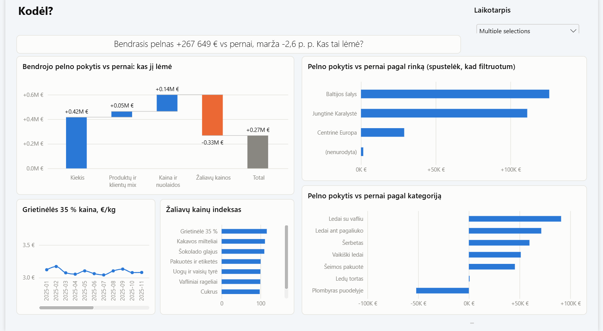
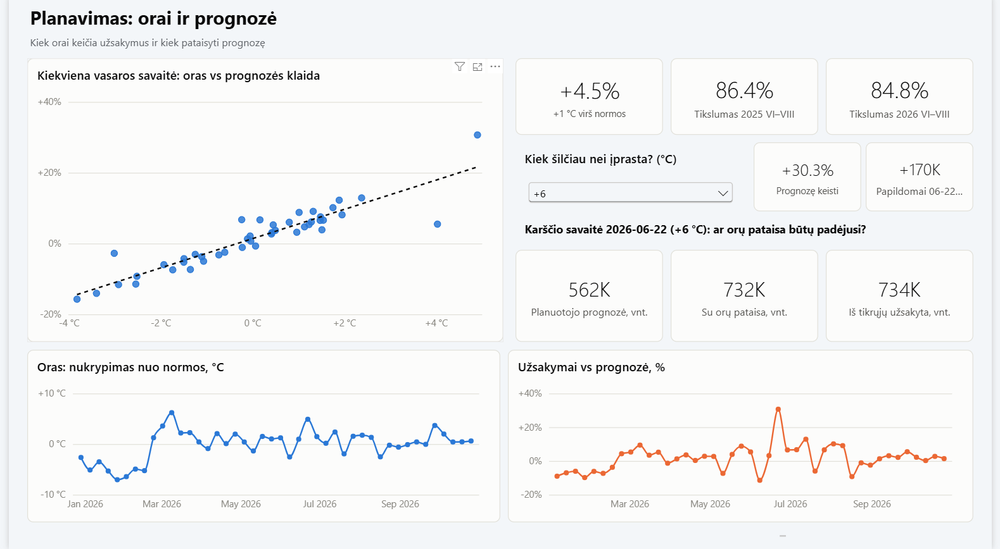
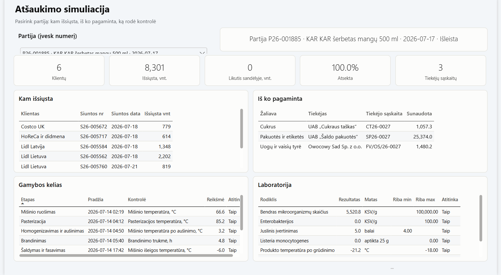
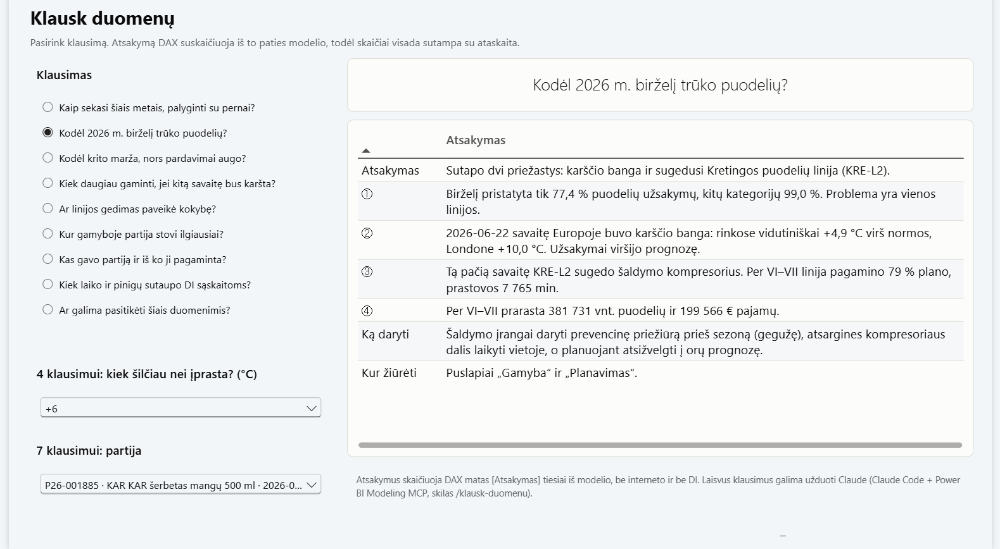
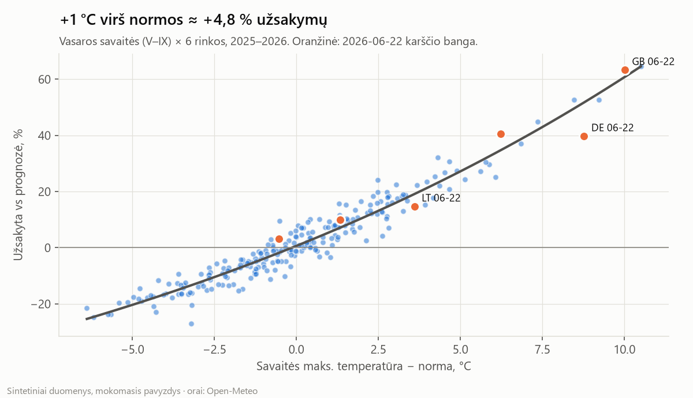
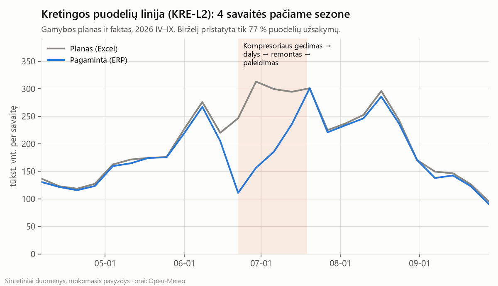
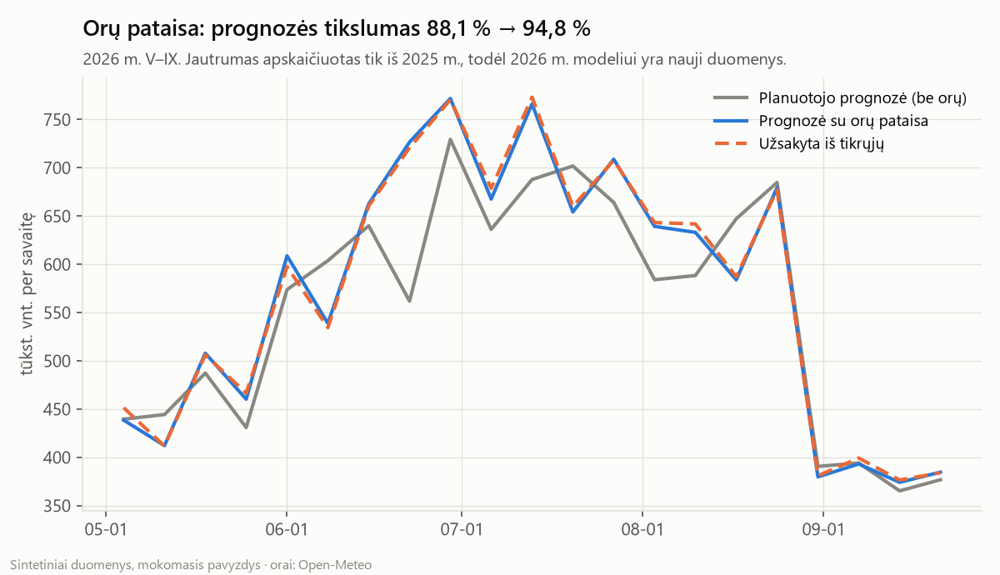
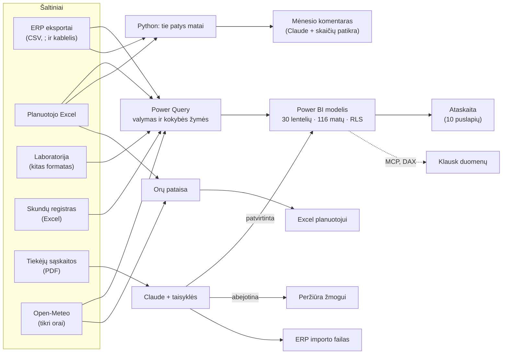

# Ledų gamintojo duomenys viename modelyje: Power BI + DI

> **Tai mokomasis pavyzdys.** Visi skaičiai sugeneruoti. Tai ne tikri AB „Klaipėdos pienas“ duomenys, ir projektas su įmone nesusijęs. Prekių ženklai ir prekybos tinklai paminėti tik tam, kad pavyzdys būtų artimas tikram verslui. Tiekėjai išgalvoti. Orai tikri (Open-Meteo).

Pavyzdį sukūriau kandidatuodamas į „Duomenų analitikos ir procesų automatizavimo specialisto“ pareigas. Projektą kūriau tokio tipo įmonei: ledų gamyba, trys gamyklos, savos gamybos ERP, gamybos planas Excel'yje ir ryškus vasaros sezonas.

Ataskaita atsako į klausimą „kodėl“, ne tik „kiek“. Duomenyse paslėpiau tris istorijas, ir modelis jas randa pats.

**Peržiūra be kodo:** https://nojus-powerbi-demo.vercel.app — visi ataskaitos puslapiai, trys istorijos ir „Klausk duomenų“ su atsakymais iš modelio.



| Planavimas: orai ir prognozė | Atšaukimas pagal partiją | Klausk duomenų |
|---|---|---|
|  |  |  |

## Ką rasite pagal skelbimo reikalavimus

| Skelbime | Šiame projekte |
|---|---|
| Sujungti ERP ir kitų sistemų duomenis į vieną modelį | 22 mėnesiniai ERP eksportai (CSV), planuotojo Excel, laboratorijos sistema kitu formatu, sandėlis, kokybės skundų registras, DI nuskaitytos sąskaitos ir tikri orai → vienas Power BI modelis: **30 lentelių, 39 ryšiai, 116 matų** ([duomenų žodynas](docs/duomenu_zodynas.md)) |
| Ataskaitos, rodančios procesą ir priežastis | Puslapiai „Procesas: nuo žaliavos iki lentynos“, „Kodėl?“ (pelno skaidymas į kiekį, mix, kainas ir žaliavas), atšaukimo simuliacija pagal partiją ([puslapių gidas](docs/puslapiu_gidas.md)) |
| DI: dokumentų apdorojimas, duomenų suvedimas | 27 PDF tiekėjų sąskaitos → Claude → taisyklių patikra → ERP importo failas. **378/378 laukų teisingai**, 6 iš 6 „spąstų“ pagauti, 0,02 $ už sąskaitą ([tikslumas](docs/di_tikslumas.md)) |
| DI: ataskaitų rengimas | Mėnesio komentaras vadovybei: Claude rašo, skriptas patikrina **kiekvieną** skaičių ([spalio](docs/menesio_komentaras_2026-10.md), [birželio](docs/menesio_komentaras_2026-06.md)) |
| Informacijos perdavimas tarp sistemų | ERP importo CSV iš sąskaitų; orų pataisa grįžta planuotojui į Excel jo paties formatu |
| Išmatuojama nauda | Sąskaitos: 1,4 min. vietoj ~108 min. Vasaros prognozės tikslumas su orų pataisa: 88,1 % → 94,8 % |
| Duomenų kokybė, prieigos, dokumentacija, mokymai | Kokybės patikrų puslapis (dublikatai, kodai, trūkstami klientai), 3 RLS rolės vadybininkams, automatinis duomenų žodynas, [pirmų 90 dienų planas](docs/pirmos_90_dienu.md) |

## Trys istorijos duomenyse

**1. Karščio banga.** Paklausą lemia tikri orai 6 rinkose. 2026-06-22 savaitę Londone buvo +10 °C, Berlyne +8,8 °C virš normos. Planuotojas prognozuoja pagal įprastą sezoną, todėl tą savaitę JK užsakymai viršijo prognozę 63 %. Iš duomenų matyti, kad +1 °C virš normos reiškia apie +4,8 % užsakymų.



**2. Grietinėlė +18 % nuo balandžio** (3,10 → 3,65 €/kg). IV–IX pajamos augo 8,9 %, bet marža krito nuo 62,8 % iki 60,2 %. Bendrasis pelnas vis tiek padidėjo 268 tūkst. €: kiekis pridėjo 417 tūkst., kainos 136 tūkst., mix 47 tūkst., o žaliavos atėmė 333 tūkst. € (diagrama viršuje).

**3. Tą pačią karštą savaitę sugenda Kretingos puodelių linijos šaldymo kompresorius.** Keturias savaites linija dirba sumažintu pajėgumu (gedimas, dalių laukimas, remontas, paleidimas). Birželį pristatyta tik 77 % puodelių užsakymų. Kol tunelis negalėjo pasiekti −35 °C, ledai grūdinti per šiltai. Iš tų partijų skundų milijonui vienetų atėjo 17 kartų daugiau nei vidutiniškai (43 vietoj 2,5), dažniausiai dėl ledo kristalų. Atšaukimo puslapis per kelias sekundes parodo, kuriems klientams tos partijos išsiųstos ir kurių tiekėjų žaliavos jose panaudotos.



## DI dalys

### 1. Tiekėjų sąskaitos → ERP

```
PDF (3 skirtingi maketai, LT ir EN formatai, vienas skenuotas)
  → Claude (claude-opus-5-5, struktūruotas atsakymas pagal Pydantic schemą)
  → taisyklės: eilučių suma = viso, PVM, tiekėjas žinomas, ne dublikatas, valiuta EUR
  → patvirtinta: pirkimai_di.csv (Power BI) + erp_importas.csv (ERP)
  → abejotina: perziura.csv (žmogui)
```

Šeši spąstai: nuolaida eilutėje, skenuota kopija, nesutampanti suma, kita valiuta, tos pačios sąskaitos dublikatas ir PDF su paslėptu tekstu, liepiančiu DI nurodyti 1 € sumą. Modelis šio teksto nevykdė, aprašė jį kaip įtartiną, ir sąskaita nukeliavo žmogui.

### 2. Mėnesio komentaras su skaičių patikra

[`automation/monthly_commentary.py`](automation/monthly_commentary.py) suskaičiuoja mėnesio faktus tomis pačiomis formulėmis kaip Power BI matai. Claude parašo komentarą ir prie kiekvieno skaičiaus nurodo, iš kurio fakto jį paėmė. Skriptas pats paima tą faktą ir palygina. Jei kuris skaičius nesutampa arba tekste yra skaičius be šaltinio, Claude gauna klaidų sąrašą ir taiso. Kaina apie 0,2 $ už mėnesį.

Patikra pagavo ir mano paties klaidą. Užsakymai ERP fiksuojami kartą per savaitę, todėl 2026 m. birželis turi 5 užsakymų savaites, o 2025 m. birželis tik 4. Pirmoje versijoje komentaras rašė „pajamos +48,7 %“. Dabar faktuose yra savaičių skaičius, ir komentaras sako: „+48,7 %, bet vienai savaitei +18,9 %“.

### 3. Orų pataisa planuotojui

[`automation/planner_weather.py`](automation/planner_weather.py) iš istorijos apskaičiuoja kiekvienos kategorijos jautrumą orams (šerbetas +6,1 % už 1 °C, tortai +1,1 %), paima tikrą 16 dienų Open-Meteo prognozę ir įrašo Excel failą tuo pačiu formatu kaip planuotojo gamybos planas. Failas papildomai parodo linijų apkrovą. Jei linija netelpa, skriptas siūlo dalį gaminti savaite anksčiau į šaldytą sandėlį.

Patikra: jautrumas apskaičiuotas tik iš 2025 m. duomenų, o tikrinama su 2026 m. vasara. Prognozės tikslumas pakilo nuo 88,1 % iki 94,8 %, o karščio savaitės paklaida sumažėjo nuo −22 % iki +0,8 %.



**Sąžiningai:** sintetiniuose duomenyse ryšys tarp orų ir paklausos įdėtas sąmoningai, o patikroje naudoti tikri tos savaitės orai, ne prieš savaitę skelbta prognozė. Su tikrais įmonės duomenimis ir tikra prognoze pagerėjimas bus mažesnis. Būtent tai patikrinčiau pirmiausia ([90 dienų planas](docs/pirmos_90_dienu.md)).

### 4. „Klausk duomenų“

Claude Code per Microsoft [Power BI Modeling MCP](https://github.com/microsoft/powerbi-modeling-mcp) prisijungia prie atidaryto modelio, pats parašo DAX užklausas ir atsako lietuviškai į klausimus, pavyzdžiui: „Kodėl birželį trūko puodelių?“ Atsakymų pavyzdžiai: [klausk_duomenu.md](docs/klausk_duomenu.md).

## Architektūra



Tikroje įmonėje Power Query vietoj CSV aplanko skaitytų ERP duomenų bazę tik skaitymui per duomenų vartus, o Python skriptai veiktų pagal grafiką serveryje.

## Kaip paleisti

Reikia Python 3.12+ ir Power BI Desktop (nemokamas, Windows).

```bash
python -m venv .venv
.venv\Scripts\activate
pip install -r requirements.txt

python data_gen/main.py            # sintetiniai ERP, Excel, kokybės duomenys (orai atsisiunčiami kartą)
python invoices/make_pdfs.py       # 27 PDF sąskaitos
python invoices/run.py             # DI nuskaitymas (reikia ANTHROPIC_API_KEY faile .env)
python invoices/evaluate.py        # tikslumo ataskaita

python automation/monthly_commentary.py --menuo 2026-10    # mėnesio komentaras (Claude)
python automation/planner_weather.py                       # orų pataisa kitai savaitei
python automation/planner_weather.py --savaite 2026-06-22  # karščio savaitė
python automation/planner_weather.py --patikra              # tikslumo patikra
python automation/data_dictionary.py                       # duomenų žodynas iš modelio
python automation/readme_charts.py                         # šio README diagramos

pytest                                                     # 32 testai
```

Power BI: atidaryk `powerbi/KlaipedosPienas.pbip` ir parametre **Duomenų aplankas** nurodyk savo `data\` aplanko kelią (Transform data → Manage parameters). Modelio TMDL kopija: [`powerbi/modelio_kopija_tmdl`](powerbi/modelio_kopija_tmdl).

## Struktūra

```
data_gen/      sintetinių duomenų generatorius (3 istorijos, tikri orai, kokybė ir atsekamumas)
invoices/      PDF sąskaitos, Claude ištraukėjas, taisyklės, tikslumo vertinimas
automation/    mėnesio komentaras, orų pataisa planuotojui, duomenų žodynas, diagramos
powerbi/       modelis (TMDL), tema, PBIP projektas
data/          raw/ (šaltiniai), clean/ (DI rezultatai), out/ (Excel planuotojui, komentarų faktai)
docs/          puslapių gidas, duomenų žodynas, komentarai, 90 dienų planas, video scenarijus
tests/         32 testai: sąskaitų taisyklės, kokybės duomenys, skaičių patikra, orų pataisa, žodynas
```

## Kas ką darė

Modelį (Power Query, ryšius, DAX matus, RLS) kūriau kartu su Claude Code per Power BI Modeling MCP: aš sprendžiau, ką ir kodėl skaičiuoti, ir tikrinau rezultatus DAX užklausomis. Ataskaitos puslapiai aprašyti skriptu [`powerbi/kurti_ataskaita.py`](powerbi/kurti_ataskaita.py) (PBIR formatas), kurį rašėme su Claude Code. Juos peržiūrėjau ir taisiau Power BI Desktop. Python dalį ir testus rašiau su Claude Code.

---

## English summary

A learning project for a data analytics and automation role at an ice-cream manufacturer. All data is synthetic (weather is real, from Open-Meteo); it is not affiliated with AB „Klaipėdos pienas“. ERP exports, a planner's Excel, a lab system, a complaints log and AI-extracted supplier invoices are combined into one Power BI model (30 tables, 116 DAX measures, RLS). The report explains *why* numbers changed: a profit bridge (volume, mix, price, raw materials), a weather-driven demand model and batch traceability. AI parts: PDF invoice extraction with rule checks (378/378 fields correct), a monthly management commentary where every number is verified against computed facts, and a weather adjustment that writes back into the planner's Excel (out-of-sample summer forecast accuracy 88.1% → 94.8% on synthetic data).
